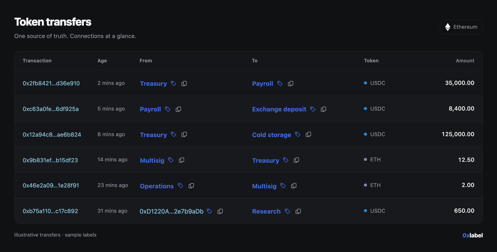
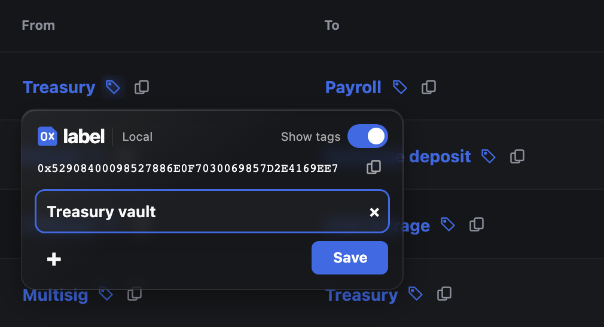

<h1 align="center">0xlabel</h1>
<p align="center"><strong>Your address book. Wherever you browse.</strong><br>Add tags in place. Recognize addresses at a glance. Keep your book on your own laptop or server.</p>
<p align="center"><a href="#get-started">Get started</a> · <a href="INSTALL.md">Setup guide</a> · <a href="docs/architecture.md">How it works</a> · <a href="LICENSE">MIT</a></p>

<picture>
  <source media="(prefers-color-scheme: dark)" srcset="docs/images/transfers-dark.png">
  <source media="(prefers-color-scheme: light)" srcset="docs/images/transfers-light.png">
  
</picture>

Build your own collection of address tags as you browse. Add a tag where you see an address, and see it again wherever that address appears. Your tags replace the site's address or preset name, while its links and copy controls keep working.

- **Easy to add.** Tag an address directly on the page with a compact inline editor.
- **Easy to find.** See your tags in place and search your growing book from the popup.
- **Your book, your storage.** Keep it on your laptop or connect to your own authenticated API. Local and remote books stay separate.
- **Fast by default.** Cached lookups handle hundreds of addresses. A simple periodic pull keeps the selected book fresh.
- **Easy to compare.** The eye reveals the website's original display. A per-site switch restores all website defaults.

Works with Etherscan-family explorers and Safe. Other enabled sites use conservative detection for full EVM addresses.

### Get started

With Python 3.10+ and [uv](https://docs.astral.sh/uv/getting-started/installation/):

```sh
git clone https://github.com/wavey0x/0xlabel.git
cd 0xlabel
uv run 0xlabel
```

1. Open `brave://extensions` or `chrome://extensions`, enable **Developer mode**, and **Load unpacked** → this project's `extension` folder.
2. Open 0xlabel. Paste the helper's connection JSON into **Connections**, then connect.
3. Enable the website in the popup. Click a blue tag beside an address to name it.



<sub>Screenshots use an explorer-style demo and sample data, rendered by the actual extension.</sub>

### Small by design

One Python process, one SQLite table, and a plain JavaScript extension. No application build step. Cached labels remain available when the API is offline; saving needs a connection.

Your book stays on the API you choose. **Websites can read labels displayed in their DOM.** API credentials stay in trusted extension storage and never reach content scripts.

Early development; installed as an unpacked extension. See the [setup guide](INSTALL.md) for remote hosting, backups, and code reloads, or [contributing](CONTRIBUTING.md) for development checks.
