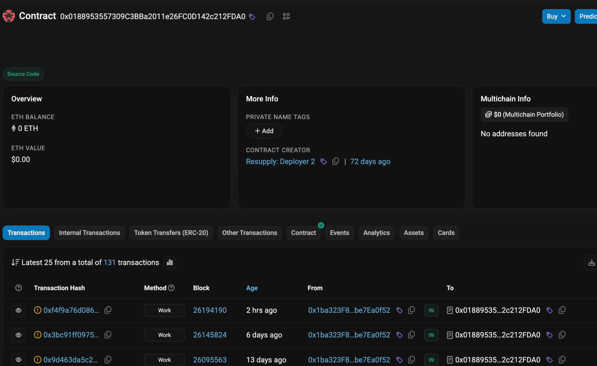

<h1 align="center">0xtagger</h1>
<p align="center"><strong>One private address book. A clearer view of the web.</strong><br>A single source of truth for your tags, overlaid on the websites you use.<br>Self-hosted on your laptop or server. No central service or account.</p>
<p align="center"><a href="#get-started">Get started</a> · <a href="INSTALL.md">Setup guide</a> · <a href="LICENSE">MIT</a></p>

<picture>
  <source media="(prefers-reduced-motion: reduce) and (prefers-color-scheme: light)" srcset="docs/images/transfers-light.png">
  <source media="(prefers-reduced-motion: reduce)" srcset="docs/images/transfers-dark.png">
  
</picture>

Collect address tags in one book and bring the same context to different websites. See recurring addresses, follow connections, and make sense of onchain activity. Add tags directly on the page; links and copy controls keep working.

- **Easy to add.** Tag an address directly on the page with a compact inline editor.
- **One consistent view.** The same tags follow addresses across enabled websites. Open the full-page book to search, add, edit, or export them.
- **Your book, your storage.** Kept on your device by default. Keep several books, each one named, and put any of them on a server you run to share it between your devices.
- **Fast by default.** Cached lookups handle hundreds of addresses. A simple periodic pull keeps the selected book fresh.
- **Easy to compare.** Reveal the website's original display for one address or the whole page, without changing your saved tags.

Works with Etherscan-family explorers and Safe. Other enabled sites use conservative detection for full EVM addresses.

### Privacy

Your addresses stay in your browser profile unless you put a book on a server you run, in which case it lives in a SQLite file you control behind an authenticated API. 0xtagger has no central service, accounts, or analytics. Access keys stay in trusted extension storage and never reach content scripts.

**Tags displayed on a website are readable by that website.** The extension keeps your stored book under your control; its on-page overlay is not hidden from the site.

### Get started

```sh
git clone https://github.com/wavey0x/0xtagger.git
```

1. Open `brave://extensions` or `chrome://extensions`, enable **Developer mode**, and **Load unpacked** → this project's `extension` folder.
2. Enable the website in the popup. Click the purple tag glyph beside an address to tag it.

That is the whole setup. Your addresses are kept on this device, with no server and nothing to configure.

#### Sharing a book between devices

Run a server, with Python 3.10+ and [uv](https://docs.astral.sh/uv/getting-started/installation/):

```sh
uv run 0xtagger
```

It prints one line. In 0xtagger, open the address book menu, choose **+ Add an address book**, and paste it. The new book lives on that server; the one on your device stays where it is, and you switch between them in the same menu.


<sub>Screenshots use an explorer-style demo and sample data, rendered by the actual extension.</sub>

### Small by design

A plain JavaScript extension, and a single Python process with one SQLite table if you want a book on a server. No application build step. A book on a server keeps a local copy, so an unreachable server costs freshness and not the book.

Early development; installed as an unpacked extension. See the [setup guide](INSTALL.md) for remote hosting, backups, updates, and development checks.
